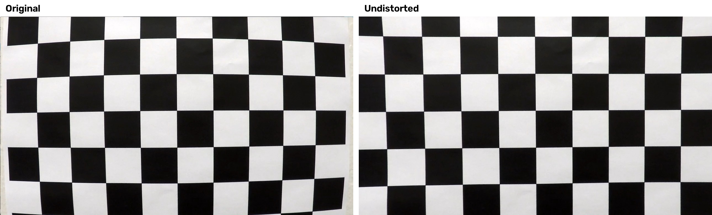
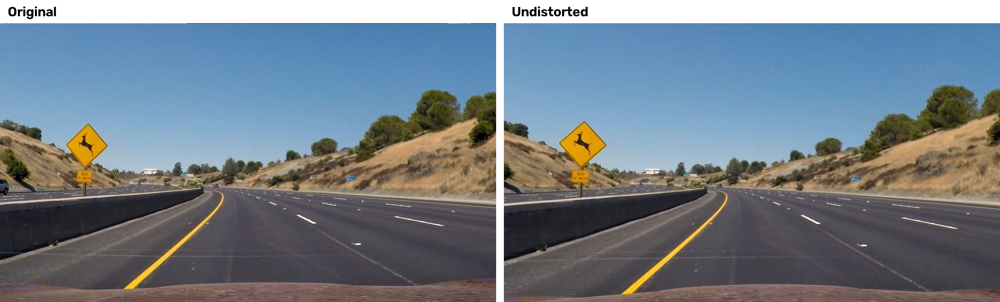
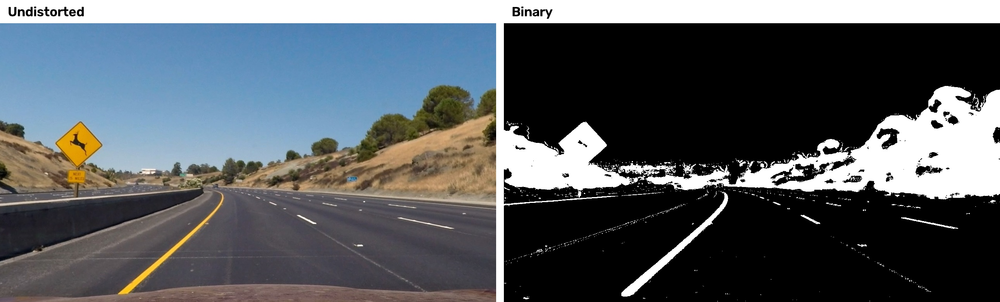
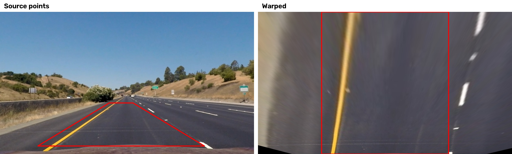
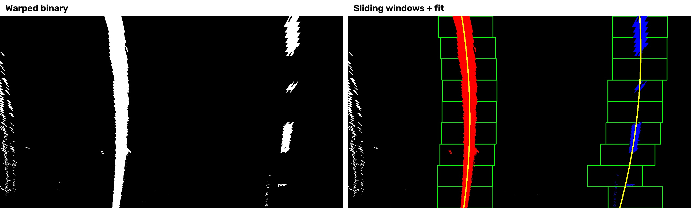
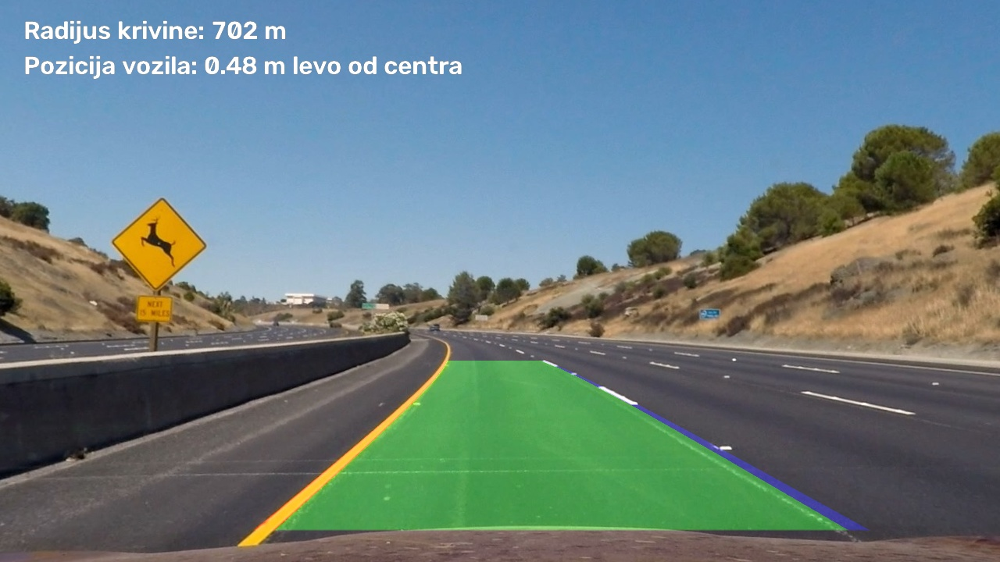

# Detekcija saobraćajne trake (Lane Finding Project)

Sistem za detekciju saobraćajne trake na slikama i video snimcima, napravljen u Python-u uz pomoć OpenCV biblioteke.

Ciljevi projekta:

* Izračunavanje matrice kamere i koeficijenata distorzije na osnovu slika šahovske table.
* Uklanjanje distorzije sa ulaznih slika.
* Pravljenje binarne slike korišćenjem transformacija boja i gradijenata.
* Perspektivna transformacija binarne slike ("birds-eye view").
* Detekcija piksela trake i fitovanje polinoma koji opisuje granice trake.
* Određivanje radijusa krivine trake i pozicije vozila u odnosu na centar trake.
* Vraćanje detektovane trake na originalnu sliku.
* Prikaz granica trake i numeričkih vrednosti krivine i pozicije vozila.

---

## Struktura projekta

```
multimedija/
├── camera_cal/          slike šahovske table za kalibraciju
├── test_images/         test slike
├── test_videos/         test video snimci
├── examples/            primeri iz postavke zadatka
└── zadatak/
    ├── main.py              pokretanje obrade slika i videa
    ├── pipeline.py          ceo tok obrade jednog frejma
    ├── calibration.py       kalibracija kamere i uklanjanje distorzije
    ├── thresholding.py      pravljenje binarne slike
    ├── perspective.py       perspektivna transformacija
    ├── lane_detection.py    detekcija linija, fitovanje, krivina, praćenje kroz video
    ├── writeup_images.py    generisanje slika za ovaj izveštaj
    ├── requirements.txt     potrebne biblioteke
    ├── tests/               unit testovi (pytest)
    ├── output_images/       rezultati na test slikama
    └── output_videos/       rezultati na test videima
```

## Pokretanje

```bash
cd zadatak
pip install -r requirements.txt

python main.py --all-images
python main.py --all-videos
python main.py --images ../test_images/test1.jpg
python main.py --videos ../test_videos/project_video01.mp4 --show
python main.py --all-videos --debug
python writeup_images.py
```

Opcija `--debug` u gornjem desnom uglu prikazuje binarnu sliku i "birds-eye" prikaz sa prozorima pretrage, a `--show` prikazuje video u prozoru tokom obrade (izlaz tasterom `q`).

---

## Kalibracija kamere

#### 1. Računanje matrice kamere i koeficijenata distorzije

Kod se nalazi u fajlu `calibration.py`, funkcija `calibrate_camera()`.

Za svaku sliku iz foldera `camera_cal` traže se unutrašnji uglovi šahovske table (9x6) funkcijom `cv2.findChessboardCorners()`, a zatim se njihova pozicija precizira funkcijom `cv2.cornerSubPix()`. "Object points" su koordinate uglova u realnom svetu, pretpostavlja se da je tabla u ravni z=0, pa su iste za svaku sliku. Na 17 od 20 slika uglovi su uspešno pronađeni (na preostalim tabla nije cela u kadru). Sa svim parovima tačaka poziva se `cv2.calibrateCamera()`, koja vraća matricu kamere i koeficijente distorzije. Rezultat se čuva u `calibration.npz` da se kalibracija ne bi ponavljala pri svakom pokretanju.

Distorzija se uklanja funkcijom `cv2.undistort()` (klasa `Undistorter`). Pošto su neke test slike i snimci rezolucije 960x540, a kalibracija je rađena na 1280x720, matrica kamere se skalira na rezoluciju ulazne slike.



## Pipeline (slike)

#### 1. Primer slike sa uklonjenom distorzijom



Razlika se najbolje vidi na ivicama slike, npr. na položaju haube i vozila sa strane.

#### 2. Binarna slika (boje i gradijenti)

Kod se nalazi u `thresholding.py`, funkcija `binary_image()`. Kombinuje se nekoliko maski:

* **žuta boja** (`yellow_mask`) - B kanal LAB prostora (u odnosu na medijanu slike, da bi radilo i na svetlijem i tamnijem asfaltu) i opseg žute boje u HSV prostoru,
* **bela boja** (`white_mask`) - L kanal HLS prostora sa adaptivnim pragom (97. percentil osvetljenosti puta, minimalno 190) i niskom zasićenošću,
* **gradijent po x osi** (`abs_sobel_thresh`) na L kanalu, ali samo tamo gde postoji i "greben" (`ridge_mask`), tj. tanka svetla struktura na tamnijoj podlozi. Greben se dobija morfološkom top-hat operacijom sa horizontalnim kernelom,
* **S kanal** HLS prostora, takođe ograničen na tanke svetle strukture.

Top-hat filter je dodat jer je sam Sobel gradijent hvatao ivice senki i prelaz između asfalta i betona (npr. u `challenge02.mp4`), a to su "stepenaste" ivice, ne tanke linije.



#### 3. Perspektivna transformacija

Kod se nalazi u `perspective.py`, klasa `PerspectiveTransform`. Izvorne (src) i odredišne (dst) tačke zadate su relativno u odnosu na veličinu slike, posebno za rezoluciju 1280x720 i 960x540, jer su snimci iz dve različite kamere. Matrice se računaju sa `cv2.getPerspectiveTransform()`, a slika se transformiše sa `cv2.warpPerspective()`.

Za 1280x720 tačke su:

| Source      | Destination |
|:-----------:|:-----------:|
| 580, 457    | 320, 0      |
| 700, 457    | 960, 0      |
| 1060, 680   | 960, 720    |
| 220, 680    | 320, 720    |

Pošto je i među snimcima iste rezolucije kamera različito postavljena (npr. u `challenge02.mp4` horizont je niže), na početku videa se automatski procenjuje tačka nedogleda (`estimate_vanishing_point()`). Na binarnoj slici se Hough transformacijom (`cv2.HoughLinesP()`) traže segmenti levih i desnih linija, kroz njih se fituju dve prave i računa njihov presek. Uzima se medijana procena iz prvih 20 frejmova, i ako su procene stabilne, trapez se pomera tako da mu stranice ostanu na pravcima ka tački nedogleda (`src_from_vanishing_point()`). Ako procena nije pouzdana, koriste se podrazumevane tačke iz tabele.

Transformacija je proverena na slici sa pravim linijama, gde su linije posle transformacije približno paralelne i vertikalne:



#### 4. Detekcija piksela trake i fitovanje polinoma

Kod se nalazi u `lane_detection.py`.

* `find_lane_pixels_sliding_window()` - na donjoj polovini binarne "birds-eye" slike računa se histogram po kolonama. Dva najveća maksimuma (levo i desno od sredine) su početne pozicije linija. Zatim se slika deli na 9 horizontalnih prozora i od dna ka vrhu se skupljaju pikseli u prozorima oko trenutne pozicije linije. Ako je u prozoru pronađeno dovoljno piksela, prozor se pomera na njihovu srednju x poziciju.
* `find_lane_pixels_around_poly()` - na videu, kada je traka pronađena u prethodnom frejmu, pikseli se traže samo u pojasu oko prethodnog polinoma, što je brže i stabilnije.
* `fit_polynomial()` - kroz pronađene piksele fituje se polinom drugog reda `x = Ay² + By + C`.



Na videu klasa `LaneDetector` dodatno proverava da li je detekcija smislena (`_sane()`): širina trake mora biti između 2.4 i 5 m, linije moraju biti približno paralelne i ne smeju previše da skoče u odnosu na prethodne frejmove. Ako provera ne prođe, ponovo se radi pretraga kliznim prozorima, a ako ni to ne uspe, koristi se prethodni rezultat. Klasa `Line` čuva poslednjih 8 polinoma i prikazuje njihov težinski prosek (noviji frejmovi imaju veću težinu), čime se smanjuje treperenje.

#### 5. Radijus krivine i pozicija vozila

Kod se nalazi u `lane_detection.py`, klasa `LaneGeometry`.

Pikseli se pretvaraju u metre pod pretpostavkom da je traka široka 3.7 m (širina između dst tačaka) i da "birds-eye" slika pokriva oko 30 m puta po dužini. Polinom se ponovo fituje u metrima i radijus se računa u dnu slike (najbliže vozilu) po formuli:

```
R = (1 + (2Ay + B)²)^(3/2) / |2A|
```

Prikazuje se srednja vrednost radijusa leve i desne linije. Za vrednosti iznad 5000 m ispisuje se da je put pravac.

Pozicija vozila se računa kao razlika između centra slike (pretpostavka je da je kamera na sredini vozila) i sredine između dve linije u dnu slike, pretvorena u metre.

#### 6. Rezultat vraćen na originalnu sliku

Kod se nalazi u `pipeline.py`, metode `draw_lane()` i `annotate()`. Prostor između linija se popunjava na "birds-eye" slici, vraća u originalnu perspektivu inverznom matricom i preklapa sa slikom bez distorzije.



Rezultati za sve test slike nalaze se u folderu `output_images/`.

---

## Pipeline (video)

#### 1. Izlazni video

Rezultati se dobijaju komandom `python main.py --all-videos` i čuvaju u folderu `output_videos/`:

* [project_video01_output.mp4](./output_videos/project_video01_output.mp4)
* [project_video02_output.mp4](./output_videos/project_video02_output.mp4)
* [project_video03_output.mp4](./output_videos/project_video03_output.mp4)
* [challenge01_output.mp4](./output_videos/challenge01_output.mp4)
* [challenge02_output.mp4](./output_videos/challenge02_output.mp4)
* `challenge03_output.mp4` (generiše se lokalno)

Na `project_video` snimcima, `challenge01` i `challenge02` traka se stabilno detektuje kroz ceo snimak, uključujući delove sa senkama, svetlim betonom i prolazom ispod nadvožnjaka. Na `challenge03` detekcija radi samo delimično (vidi diskusiju).

Izlaz za `challenge03` (oko 72 MB) nije dodat u repozitorijum zbog veličine, već se dobija komandom `python main.py --videos ../test_videos/challenge03.mp4`.

---

## Unit testovi

Testovi su napisani u `pytest`-u i nalaze se u folderu `tests/`, po jedan fajl za svaki modul. Za svaki deo pipeline-a proverava se osnovni slučaj kada sve radi ispravno i nekoliko slučajeva sa lošim ulazom ili parametrima. Kao ulaz se uglavnom koriste male veštačke slike (prazan put, nacrtane linije), a za kalibraciju prave slike iz `camera_cal`.

Pokretanje:

```bash
cd zadatak
python -m pytest tests -v
python -m pytest tests/test_perspective.py -v
```

| Fajl | Ispravan rad | Loš ulaz / parametri |
|------|--------------|----------------------|
| `test_calibration.py` | koriste se slike iz zadatog foldera (17 od 20), matrica kamere je 3x3 sa smislenim vrednostima, `Undistorter` zadržava veličinu slike i skalira matricu za 960x540, učitavanje sačuvane kalibracije | prazan folder, slika bez šahovske table i pogrešna veličina table bacaju `cv2.error` |
| `test_thresholding.py` | bela i žuta linija se pronalaze, rezultat je binarna slika (0/1) iste veličine, top-hat pronalazi tanku liniju | prazan put daje praznu binarnu sliku, "stepenasta" ivica (prelaz asfalt/beton) se ne prepoznaje kao linija |
| `test_perspective.py` | izlaz je iste veličine, src tačke se preslikavaju u dst, `Minv` je inverz od `M`, širina trake u pikselima, tačka nedogleda na veštačkim linijama, preset tačke se dobijaju iz preset tačke nedogleda | 3 tačke umesto 4 bacaju `cv2.error`, 4 tačke na istoj pravoj daju degenerisanu matricu, nepoznata rezolucija koristi podrazumevani preset, prazna slika ili samo jedna linija daju `None` |
| `test_lane_detection.py` | klizni prozori pronalaze obe linije, fit vertikalne linije, radijus krivine (prava i kriva), pozicija vozila, širina trake, usrednjavanje u `Line`, `LaneDetector` pronalazi traku | premalo piksela za fit vraća `None`, preuska traka se odbacuje, prazna slika ne daje rezultat, posle 10 promašaja `Line` se resetuje |

Svih 36 testova prolazi.

---

## Diskusija

#### 1. Problemi i moguća poboljšanja

* **Različite kamere** - test materijal je snimljen sa najmanje dve kamere različite rezolucije i položaja, pa su tačke za perspektivnu transformaciju podešene posebno za svaku rezoluciju. Kalibracija postoji samo za jednu kameru, pa je za snimke 960x540 uklanjanje distorzije samo približno.
* **Senke i promene podloge** - prvo rešenje sa Sobel gradijentom i S kanalom davalo je mnogo šuma na senkama i na prelazu asfalt/beton. To je ublaženo adaptivnim pragovima i top-hat filterom.
* **challenge02** - deo puta je od betona, a deo od asfalta, pa nastaje jaka ivica po sredini trake. Bez top-hat filtera ta ivica je bila prepoznata kao linija. Pored toga, kamera je postavljena drugačije nego na ostalim snimcima, pa sa fiksnim tačkama linije u "birds-eye" prikazu nisu bile paralelne i provera širine trake je odbacivala skoro sve frejmove. To je rešeno automatskom procenom tačke nedogleda.
* **challenge03** - najteži snimak: oštre krivine, jako sunce i duboke senke drveća, odsjaj na staklu. Ovde pipeline često ne uspeva, jer linija u oštroj krivini izlazi iz oblasti perspektivne transformacije, a jaka svetla područja vegetacije prolaze kroz filter za belu boju.

Pipeline će verovatno praviti greške:

* u oštrim krivinama i na brdovitom putu (pretpostavka ravnog puta kod perspektivne transformacije ne važi),
* kada vozilo menja traku ili kada je drugo vozilo direktno ispred,
* noću, po kiši ili kada su linije izbledele.

Moguća poboljšanja:

* dinamičko određivanje oblasti transformacije (kraći "pogled unapred" u oštrim krivinama),
* procena jedne linije na osnovu druge kada je samo jedna pouzdano detektovana,
* adaptivni pragovi po delovima slike (CLAHE ili normalizacija osvetljenja),
* praćenje tačke nedogleda tokom celog snimka, ne samo na početku (nagib puta se menja).
